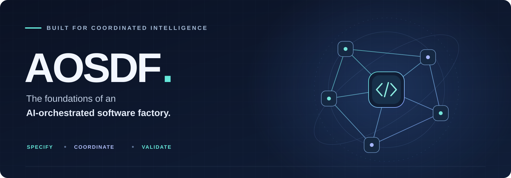
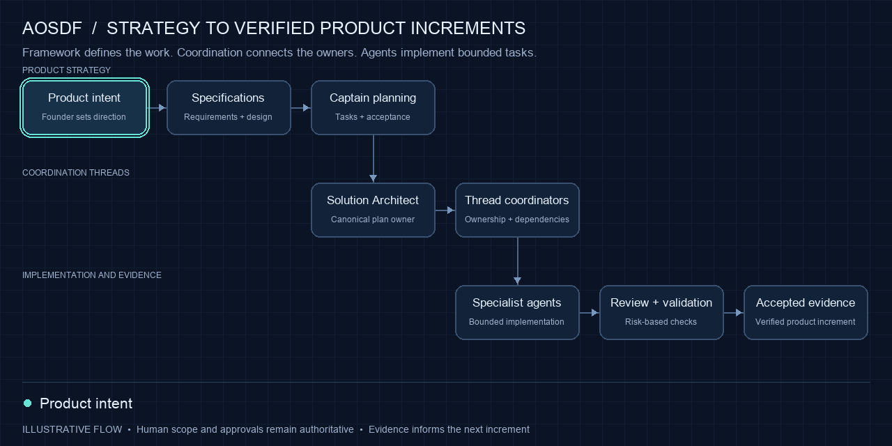

<p align="center">
  
</p>

<h1 align="center">AI-Orchestrated Software Development Framework</h1>

<p align="center">Turn product ideas into structured plans, coordinated agents, and verifiable work.</p>

<p align="center">
  <a href="prompts/setup_aosdf.md"><strong>Get started</strong></a> ·
  <a href="manual.md">Read the guide</a> ·
  <a href="framework.md">Explore the specification</a> ·
  <a href="automation/README.md">Automation</a> ·
  <a href="automation/coordination-threads/README.md">Coordination threads</a> ·
  <a href="examples/coordinated-development/README.md">See an example</a>
</p>

---

AOSDF provides the **foundations of an AI-orchestrated software factory**. It connects requirements, architecture, implementation, and validation through a shared development model, giving AI agents clear responsibilities and teams a durable record of decisions and results.

Use it to bring structure to AI-assisted development, from a single implementation session to coordinated work across multiple threads.

## Strategy gives direction. Agents carry the work.

AOSDF supplies the strategic framework: requirements, architecture, security constraints, milestones and acceptance criteria. Coordination threads turn that plan into bounded assignments for specialist agents, with explicit ownership and cross-thread handoffs. Automation carries messages and evidence between those owners while preserving the same scope, review and authorization rules.

<p align="center">
  <a href="assets/diagrams/aosdf-flow.html"></a>
</p>

[Explore the interactive flow](assets/diagrams/aosdf-flow.html) · [Static illustration](assets/diagrams/aosdf-flow.png) · [Automation guide](automation/README.md)

The animation illustrates the process; it is not live project telemetry. Open the HTML locally for tracing, focus and presentation controls. A configured installation's `python3 automation/automode.py watch` provides the live operational console.

## From idea to verified work

1. **Define the product.** Capture requirements, system design, and security constraints before implementation begins.
2. **Plan the work.** Translate those decisions into milestones, bounded tasks, and acceptance criteria.
3. **Coordinate execution.** Give specialized agents explicit ownership, dependencies, and handoff contracts.
4. **Validate the result.** Review work in proportion to risk, record evidence, and preserve context for the next session.

Humans set direction and approve key boundaries. Agents work within the project's agreed scope. Reusable automation ships inactive; enabling real runners is a project-specific step.

## What you get

| Capability | What it brings to your workflow |
| --- | --- |
| **Specification-driven planning** | Product definitions, architecture decisions, execution plans, and reusable document templates. |
| **[Coordination threads](automation/coordination-threads/README.md)** | Architect, coordinator, worker, reviewer, and validator roles with explicit ownership and durable handoffs. |
| **Risk-based quality gates** | One review during implementation, with independent review for high-risk work, and required acceptance checks. |
| **Outcome-first delivery** | Make the acceptance path work, defer optional refinement to one hardening list, and keep founder decisions visible through the inbox. |
| **Persistent project context** | Documentation, task state, and accepted evidence that carry work across sessions. |
| **Developer integrations** | An [MCP server](aosdf-mcp/README.md), [VS Code extension](aosdf-vscode/README.md), and [document tooling](tools/README.md). |
| **Learning and documentation** | [Study material](study_material/README.md), project documentation templates, and an independently buildable [public website](website/README.md). |

## Automation and coordination threads

**[Open the automation guide](automation/README.md)** — the whole bundle now lives under one parent: `automation/`. [Coordination contracts](automation/coordination-threads/README.md), [per-mode folders](automation/modes/README.md), shared scripts and notifications live together.

| Start here | Purpose |
| --- | --- |
| [Coordinator](automation/coordination-threads/coordinator-definition.md) | Entry point for coordinating a development thread. |
| [Solution Architect](automation/coordination-threads/solution-architect.md) | Maintains the canonical execution plan and aligns work across threads. |
| [Worker](automation/coordination-threads/worker-definition.md) | Implements bounded assignments and reports results and evidence. |
| [Automation](automation/README.md) | Dispatch, claims, recovery, and result reconciliation; inactive by default. |
| [Worked example](examples/coordinated-development/README.md) | Follow a synthetic project through ownership, handoffs, and validation. |

During project setup, install the whole `automation/` bundle into `05_AI_Agent_System/automation/`, with thread records in its `coordination-threads/` subfolder in the project's documentation tree. Each project creates its own `thread<N>/` and worker records after choosing its topology and ownership. Live product assignments and run history stay with that project.

## Start a project

```sh
git clone https://github.com/mvsingh07/AOSDF.git
cd AOSDF
```

Follow the **[setup guide](prompts/setup_aosdf.md)** to create your project workspace and customize the setup prompt. The [workflow initiator](workflow_initiator.md) helps establish the project structure and identify missing inputs.

For a practical introduction to parallel work, walk through the [synthetic coordination example](examples/coordinated-development/README.md). For an existing installation, use the [upgrade guide](upgrades/README.md).

### Choose how much to automate

Manual → Semi-auto → Easy → Auto progressively delegate coordination within project-approved boundaries. The optional **Ultimate Auto** extension wakes existing bound owners for unread rounds, peer questions and results; it keeps worker dispatch and protected-operation approvals intact. All modes share one engine. [Mode definitions and setup](automation/modes/README.md).

## Open framework, companion service

This repository contains the reusable framework, coordination tooling, integrations, learning content, and public website. You can use AOSDF and build project documentation without a hosting account.

The companion **AOSDF Hosting** application provides GitHub-connected documentation builds, deployment, and role-based project sharing. Its implementation and live project records remain in separate private repositories. See the [repository boundaries](docs/repository-boundaries.md).

AOSDF is building toward repeatable specification-to-release delivery. It does not yet claim fully autonomous production delivery across projects.

## Go deeper

- [Plain-language manual](manual.md) — understand the development model.
- [Full specification](framework.md) — explore the framework and agent architecture.
- [Coordination guide](automation/coordination-threads/README.md) — configure threads and handoffs.
- [Workflow rules](reference/current-workflow-rules.md) — consult the authoritative process contracts.
- [Contributing](CONTRIBUTING.md) — improve the framework and run relevant checks.

---

Created by **[Manvir Singh](https://www.mvsingh.in)** · [LinkedIn](https://www.linkedin.com/in/mvsingh07)

[MIT License](LICENSE) · [Third-party credits](THIRD_PARTY_NOTICES.md) · [Report a security issue](SECURITY.md)
